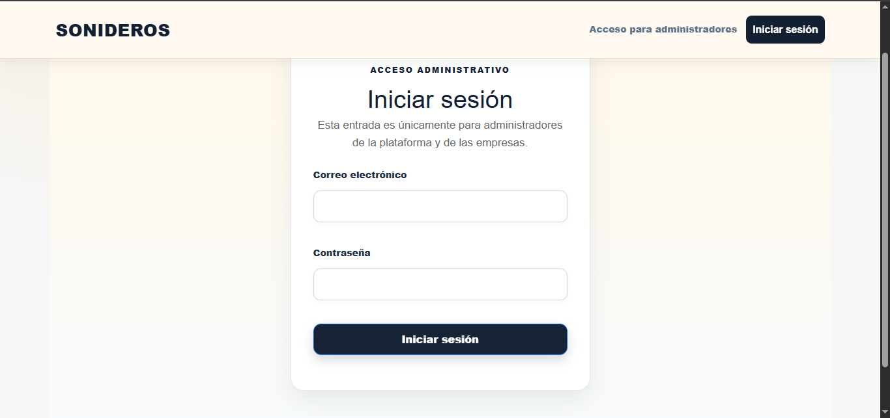

**Project Overview:**

SONIDEROS es una aplicación web diseñada para facilitar la administración de negocios dedicados a ofrecer servicios de sonido para eventos. La plataforma permite que cada empresa cuente con su propio espacio personalizado, donde puede mostrar sus servicios, administrar paquetes y recibir solicitudes de reserva de sus clientes.

**## Objectives**

1. Desarrollar una plataforma que permita administrar diferentes negocios de sonideros desde un mismo sistema.
2. Facilitar la publicación de servicios y paquetes para los clientes.
3. Gestionar solicitudes de reserva y mantener organizada la información de cada empresa.

**## Features**

1. **Gestión multiempresa:**
   - Cada sonidero cuenta con su propio espacio e identidad visual.
   - La información de cada empresa se mantiene independiente.

2. **Administración de servicios y paquetes:**
   - Registro y edición de servicios, paquetes, precios y descripciones.
   - Publicación de contenido e información de cada negocio.

3. **Sistema de reservas:**
   - Los clientes pueden consultar disponibilidad y solicitar reservas.
   - Administración de fechas, anticipos y estados de las solicitudes.

4. **Gestión de usuarios:**
   - Acceso diferenciado para administradores de empresa y clientes.
   - Registro, inicio de sesión y administración de cuentas.

5. **Notificaciones por correo:**
   - Envío de correos electrónicos relacionados con las operaciones del sistema.

**## Technology Stack**

- Backend: PHP.
- Frontend: HTML, CSS y JavaScript.
- Framework de estilos: Bootstrap 5.
- Database: MySQL.
- Servidor: Apache.
- Arquitectura: Modelo-Vista-Controlador (MVC).
- Herramientas: Composer y PHPMailer para la gestión del envío de correos.

**## Outcome**

Se desarrolló una plataforma web que permite centralizar la administración de diferentes negocios de sonideros, ofreciendo herramientas para gestionar sus servicios, paquetes, clientes y reservas mediante espacios independientes y personalizables.
