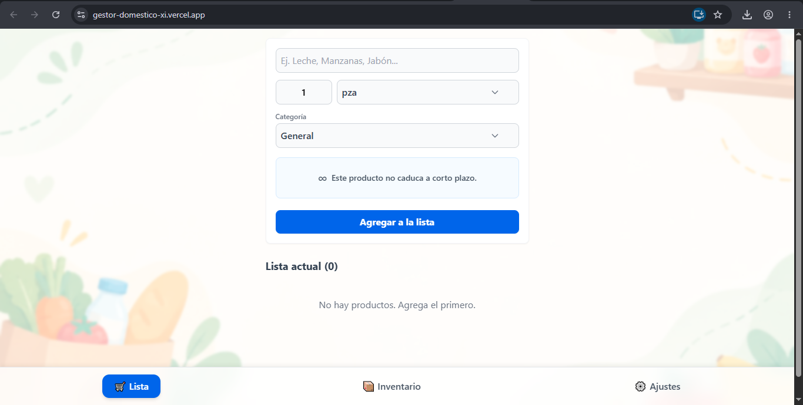

## Descripción del Proyecto

Gestor Doméstico es una aplicación web progresiva (PWA) desarrollada para facilitar la organización de las compras y la administración de productos del hogar. Permite crear listas de compra, gestionar un inventario doméstico y consultar información sobre los productos almacenados, incluyendo sus fechas de caducidad.

## Objetivos

1. Facilitar la organización de las compras del hogar.
2. Mantener un registro de los productos disponibles en el inventario.
3. Ofrecer una aplicación accesible y funcional incluso sin conexión a internet.

## Características

1. **Lista de compras:**
   - Agregar, modificar y eliminar productos.
   - Organizar cantidades y unidades de los artículos.
   - Transferir los productos comprados al inventario.

2. **Inventario doméstico:**
   - Registrar productos, cantidades y ubicaciones de almacenamiento.
   - Consultar el estado de los productos y sus fechas de caducidad.
   - Actualizar existencias y administrar los artículos registrados.

3. **Notificaciones:**
   - Alertas sobre productos próximos a caducar.
   - Notificaciones mediante el navegador.

4. **Respaldo de información:**
   - Exportar los datos del inventario y la lista de compras.
   - Importar respaldos para recuperar la información.

5. **Características PWA:**
   - Instalación como aplicación desde el navegador.
   - Almacenamiento local de información.
   - Acceso a funcionalidades principales sin conexión a internet.

## Tecnologías Utilizadas

- Frontend: React y JavaScript.
- Estilos: CSS y Tailwind CSS.
- Build Tool: Vite.
- Database: IndexedDB mediante Dexie.
- PWA: Vite PWA Plugin y Workbox.
- Herramientas: Node.js y npm.

## Resultado

Se desarrolló una aplicación web progresiva que permite organizar las compras y mantener un inventario doméstico de manera práctica. Su almacenamiento local y sus características PWA permiten consultar y administrar la información sin depender constantemente de una conexión a internet.
