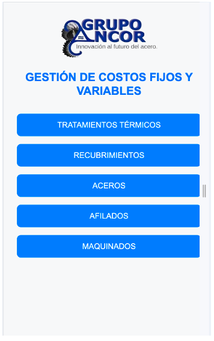

## Descripción del Proyecto

Grupo Ancor es un sitio web desarrollado para una empresa dedicada a la comercialización de productos de acero. Su propósito es ofrecer un espacio digital donde los clientes puedan conocer los productos disponibles y realizar cotizaciones de acuerdo con sus necesidades.

## Objetivos

1. Desarrollar una plataforma web para presentar los productos y servicios de la empresa.
2. Facilitar a los clientes la consulta de productos y sus características.
3. Implementar un sistema de cotizaciones que permita solicitar información sobre pedidos.

## Características

1. **Catálogo de productos:**
   - Consulta de productos relacionados con la comercialización de acero.
   - Presentación de información para facilitar la selección de materiales.

2. **Sistema de cotizaciones:**
   - Selección de productos para elaborar cotizaciones.
   - Registro de solicitudes de cotización para pedidos.

3. **Información comercial:**
   - Presentación de información general de la empresa.
   - Acceso a información relacionada con sus productos y servicios.

## Tecnologías Utilizadas

Las tecnologías utilizadas en el desarrollo se detallarán una vez revisado el código fuente del proyecto, cómo php, html, etc.

## Resultado

Se desarrolló un sitio web que permite a Grupo Ancor contar con una presencia digital y facilita a sus clientes la consulta de productos y la solicitud de cotizaciones, haciendo más accesible el proceso de consulta y atención comercial.
